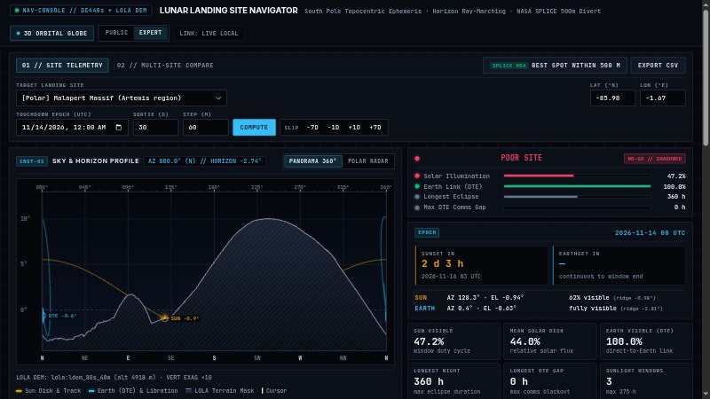
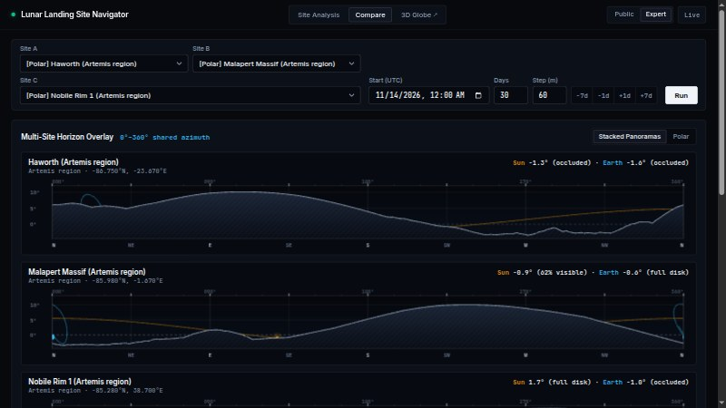
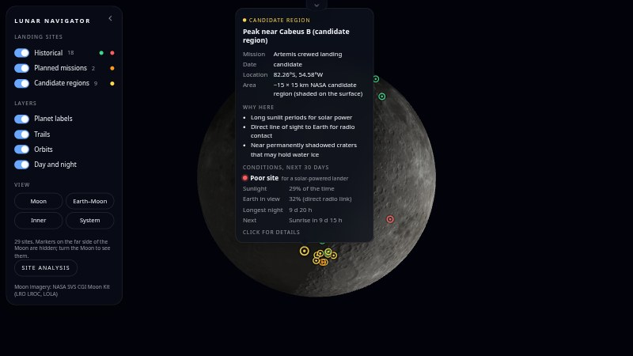

# NASA Space Apps Challenge — Rzeszów

Team project for the Space Apps hackathon in Rzeszów: Lunar Landing Site Navigator. Compare lunar landing sites and dates by Sun and Earth visibility over the real LOLA terrain horizon (solar power and direct-to-Earth windows).

**Try it without installing anything:** https://jedynatv1-cell.github.io/space-apps-rzeszow/ (static demo replaying real server responses for 4 sites; the full app with any coordinates runs locally, see Quick start).





## Layout

| Path       | Purpose                                   |
|------------|-------------------------------------------|
| `src/`     | Rust code (`cargo run`)                   |
| `data/`    | Small datasets (raw downloads go in `data/raw/`, git-ignored) |
| `scripts/` | Helper scripts (Python / Node)            |
| `docs/`    | Notes, pitch, diagrams                    |

## Quick start

1. Put the NAIF kernels in `data/raw/kernels/` (git-ignored, ~45 MB — URLs in [RESEARCH.md](docs/RESEARCH.md) TL;DR):
   `de440s.bsp`, `moon_pa_de440_200625.bpc`, `moon_fk_de440.epa`
2. Run the server and open http://localhost:3000 (sky plot, timeline, compare; `?recorded=1` replays saved responses without a server). 3D Moon-centred view: http://localhost:3000/solar.html

```bash
cargo run
```

API: `GET /api/sites`, `GET /api/track?lat=-89.45&lon=-129.78&start=2026-11-14&days=30&step_min=60`

Before pushing:

```bash
cargo fmt && cargo clippy --all-targets -- -D warnings && cargo test
```

### Code map

| Module | Owner | What |
|---|---|---|
| `src/ephem.rs` | A | Sun/Earth az/el via ANISE (verified vs JPL Horizons) |
| `src/dem.rs`, `src/horizon.rs` | B | LOLA DEM reader, terrain horizon mask |
| `src/metrics.rs`, `src/api.rs` | C | visibility windows, sunset/Earthset, HTTP API |
| `web/` | D | frontend |
| `data/sites.json`, `docs/` | E | landing sites, validation, pitch |

## Docs

- **[HANDOFF.md](docs/HANDOFF.md): current status, how to move the project, next steps (start here)**
- [COORDINATION.md](docs/COORDINATION.md) — how 2 Claude chats + Antigravity work in parallel

- [SETUP.md](docs/SETUP.md) — install the toolchain from scratch
- [CONTRIBUTING.md](docs/CONTRIBUTING.md) — branches, commits, PRs
- [CHALLENGE.md](docs/CHALLENGE.md) — chosen challenge, datasets, MVP scope
- [ARCHITECTURE.md](docs/ARCHITECTURE.md) — structure, stack, decisions
- [SUBMISSION.md](docs/SUBMISSION.md) — submission checklist and pitch plan

## Toolchain

Git, Rust (stable, MSVC) + clippy/rustfmt/rust-analyzer, Node.js LTS, Python 3, GitHub CLI.

## License

Code: MIT (see `LICENSE`). Data: NASA/JPL/LRO products are public domain; third-party libraries keep their own licenses (Three.js: MIT).
